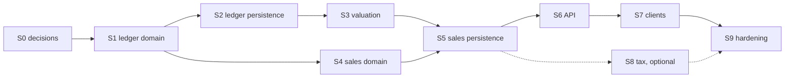

# Plan 005. Build 3: sales and ledger posting foundation

Status: **APPROVED / S0 COMPLETE / S1 READY.** ADR-009, ADR-010 and ADR-011 were **ACCEPTED on 2026-10-15** by the
human maintainer. Accountant review is **COMPLETE** (Osasu, 2026-10-15; `docs/reviews/build-3-accountant-review.md`
sections 14 and 14.1): ADR-009 A1 to A22 and ADR-010 T1 to T7 approved. Maintainer questions M1 to M17 are resolved
(section 4). **No implementation has started**; S1 is unblocked and S2 to S9 are not started.

Scope: the ledger posting foundation, the default chart of accounts, perpetual weighted average cost valuation with
explicit valuation status, and online, fully tendered sales with full reversal (ADR-009, ADR-011). Configurable tax
(ADR-010, accepted as architecture only) only if a separately reviewed pilot configuration is approved.

Not in Build 3: AI, voice, WhatsApp, photo capture; purchasing and payables; reconciliation; daily close completion;
advanced reporting; offline sync implementation; credit sales and receivables; customer returns and refunds; pack
selling; price override; sale-level discounts; account management UI; period close.

## Slices and status

| Slice | Name                                   | Governing ADR        | Status                     |
| ----- | -------------------------------------- | -------------------- | -------------------------- |
| S0    | Decisions                              | (produces the ADRs)  | **Complete** (2026-10-15)  |
| S1    | Ledger domain and application          | ADR-009              | Ready (unblocked); not started |
| S2    | Ledger persistence and consistency     | ADR-009              | Not started (after S1)     |
| S3    | Valuation and cost foundation          | ADR-009              | Not started (after S2)     |
| S4    | Sales domain and application           | ADR-011, ADR-009     | Not started (after S1)     |
| S5    | Sales persistence and SALE integration | ADR-011, ADR-009     | Not started (after S3, S4) |
| S6    | API                                    | ADR-011, ADR-009     | Not started (after S5)     |
| S7    | Clients (web and mobile)               | ADR-011              | Not started (after S6)     |
| S8    | Configurable tax (optional)            | ADR-010              | Not started; optional; needs a separately reviewed pilot tax configuration; may be deferred |
| S9    | Hardening and acceptance               | All accepted         | Not started (after S7, and S8 if run) |

## 1. Delivery sequence

## 2. Slice detail

Each slice: outcome, dependencies, modules and files, tests, gate, stop condition. Every slice follows ADR-004
(UnitOfWork, idempotency, audit), the definition of done in `AGENTS.md` section 7 and `60-testing.mdc`.

### S0. Decisions

- Outcome: ADR-009, ADR-010 and ADR-011 accepted (or explicitly changed) by the maintainer; accountant answers
  recorded; maintainer questions (section 4) answered; `mvp-scope.md` open decisions 5, 6, 7 and 9 updated by a human.
- Dependencies: none.
- Files: `docs/decisions/ADR-009..011`, `docs/reviews/build-3-accountant-review.md`, `docs/product/mvp-scope.md`,
  `docs/decisions/README.md`.
- Tests: none (documentation). Prettier, text integrity, `git diff --check`.
- Gate: maintainer marks each ADR Accepted; accountant review table complete.
- Stop: any accountant CHANGE answer that alters a posting rule returns the ADR to drafting.
- Status: **COMPLETE (2026-10-15).** Accountant review complete (A1 to A22, T1 to T7); maintainer questions M1 to
  M17 resolved; ADR-009, ADR-010 and ADR-011 accepted by the human maintainer on 2026-10-15; `mvp-scope.md` open
  decision 6 resolved and open decisions 5, 7 and 9 narrowed; ADR index updated. S1 is unblocked.
- Tax: the configurable tax architecture (ADR-010) is accepted and its framework review (T1 to T7) is complete.
  Actual pilot tax configuration and rates remain a separate, later review and are never invented; S8 still requires
  that configuration to be approved. Until then every sale line snapshots `NONE`.

### S1. Ledger domain and application

- Outcome: pure ledger domain (account types, roles, chart template version 1, `PostingPlan` with balancing,
  reversal mirroring) and the application posting port, chart provisioning use case and read use cases.
- Dependencies: ADR-009 Accepted.
- Modules: `packages/domain/src/modules/ledger`, `packages/application/src/modules/ledger`, permission `ledger:read`,
  audit action `ledger.chart_provisioned`, dependency-cruiser rules (posting port importers; AI boundary).
- Tests: balancing (including property-style generated plans), zero-line omission, currency mismatch, reversal mirror,
  role resolution, provisioning idempotency, unauthorized tenant, permission matrix, audit payloads.
- Gate: unit and application tests green; boundary rules enforced.
- Stop: any need for a public posting entry point, or a posting rule that cannot be expressed by roles.

### S2. Ledger persistence and consistency

- Outcome: migrations for `ledger_accounts`, `journal_entries`, `journal_lines` (grants: SELECT, INSERT), typed
  source columns added as their sources arrive; repositories; `db:ledger-consistency`; `verify-schema` expectations;
  chart provisioning for new businesses in the creation transaction and the operator command for existing ones.
- Dependencies: S1.
- Modules: `packages/database` (schema, migrations, repositories), `scripts/check-ledger-consistency.mjs`,
  `verify-schema.mjs`.
- Tests: DB tests for grants (no UPDATE/DELETE), composite tenant FKs, one original per source, at most one reversal,
  cross-tenant isolation, consistency script on seeded good and deliberately broken data (test database only).
- Gate: migrations apply forward on a fresh and on a Build 2 database; consistency clean.
- Stop: any need to backfill business data in a migration, or to alter Build 2 history.

### S3. Valuation and cost foundation

- Outcome: `inventory_valuations`, `inventory_movement_valuations`, `stock_valuations`; WAC in total-value form;
  initial opening valuation use case; optional cost on opening stock and goods receipts (OWNER/MANAGER only); value
  postings for valued adjustments, write-offs, counts and reversals; costless receipts turning valued items
  `UNVALUED`; the **operational valuation** use case with the approved A22 posting rule (ADR-009 section 20.3:
  increase Dr `INVENTORY` / Cr `INVENTORY_GAIN`, decrease Dr `INVENTORY_SHRINKAGE` / Cr `INVENTORY`, never
  `OPENING_BALANCE_EQUITY`); extended `db:inventory-consistency`.
- Dependencies: S2.
- Modules: `packages/domain/src/modules/inventory` (valuation), `packages/application/src/modules/inventory` (Build 2
  use cases gain valuation calls), permission `inventory:value`, audit `inventory.valuation_recorded`.
- Tests: WAC rounding and last-unit exactness, status transitions, unvalued behaviour (no postings), staleness,
  initial versus operational valuation kind decided server-side, operational valuation increase, decrease and
  zero-difference cases (ADR-009 examples M and N; no `OPENING_BALANCE_EQUITY` line; reason required;
  `VALUATION_STALE`; no change to earlier COGS), STOCK_KEEPER cost entry denied, reversal of
  snapshotted value, the `INVENTORY` account invariant, server-time business date (a device-reported time never
  changes it), Build 2 quantity behaviour unchanged (existing suites stay green), unauthorized tenant, idempotent
  replay, audit.
- Gate: all Build 2 tests green; invariant holds in the soak.
- Stop: any rule that would rewrite existing movements or invent a cost.

### S4. Sales domain and application

- Outcome: sale aggregate (lines, discounts, tenders, totals, posting rule `SALE_POSTED` v1, reversal), RecordSale
  and ReverseSale use cases with price-version check, stock check, valuation, posting, receipt number and audit.
- Dependencies: S1; ADR-011 Accepted.
- Modules: `packages/domain/src/modules/sales`, `packages/application/src/modules/sales`, permissions `sales:*`,
  audit `sale.recorded`, `sale.reversed`.
- Tests: success per tender method, split tender, tender mismatch, cash received and change snapshots without ledger
  effect, discount rules (100% and 10,000 basis points rejected, rounding never reaching the gross) and permission,
  price changed, price not set, archived, insufficient stock writes nothing, untracked lines, unvalued lines,
  200-line and 10-tender limits, reversal (OWNER/MANAGER only, reason and tender-unwind confirmation required),
  double reversal, CASHIER own-sales read scope, cost fields hidden from CASHIER and STOCK_KEEPER, business date from
  server time only, idempotent replay and key reuse, unauthorized tenant, audit, every posting example A to I as a
  test.
- Gate: application tests green with in-memory adapters.
- Stop: a need for credit, partial payment or price override.

### S5. Sales persistence and SALE integration

- Outcome: migrations for `sales`, `sale_lines`, `sale_tenders`, `sale_receipt_sequences`; `SALE` movement type and
  `sale_id` sources on movements and journal entries; repositories; `db:sales-consistency`.
- Dependencies: S3, S4.
- Tests: DB tests for grants, FKs, lock order under concurrent sales and stocktake posting, no negative balance under
  concurrency, receipt number uniqueness, cross-tenant isolation; soak extended with sales.
- Gate: consistency scripts clean after soak.
- Stop: deadlocks or lock waits that need a change to ADR-008 lock order.

### S6. API

- Outcome: thin controllers for sales and ledger reads; shared Zod contracts; response mappers; route list and guard
  compatibility test extended.
- Dependencies: S5.
- Tests: integration tests per route and error code, device trust, permission denial, cross-tenant `404`.
- Gate: API suites and route-guard compatibility green.
- Stop: any business rule appearing in a controller.

### S7. Clients

- Outcome: web and mobile selling screen (memory-only cart, catalog search, stock-unit quantities, line discount for
  permitted roles, tenders with "not verified" labels, cash received and change, receipt view), sales list and detail
  (own sales only for CASHIER), reversal for OWNER/MANAGER with a required reason and an explicit "original tender
  has been returned or unwound" confirmation, valuation screen for stock needing valuation, "cost unknown" and
  incomplete-margin labelling, read-only ledger view for `ledger:read`.
- Dependencies: S6.
- Tests: component tests, Playwright e2e for a sale and a reversal, client bundle check (no server packages).
- Gate: client suites, bundle check and a manual walkthrough on the reference Android device.
- Stop: any authoritative calculation needed on the client.

### S8. Configurable tax (optional)

- Optional. ADR-010 is Accepted (architecture only); S8 runs only if a **separately reviewed pilot tax configuration**
  is also approved; otherwise deferred, and every line snapshots `NONE`. ADR-010's acceptance is not that approval.
- Outcome: `tax_treatments`, variant assignment, line calculation and snapshots, `TAX_PAYABLE` postings, configuration
  screens, permission `tax:manage`, audit actions, and the M17 reactivation check added to the Build 2
  ReactivateProduct use case (ADR-010 section 5).
- Tests: exclusive and inclusive examples, rounding modes, zero-rated and exempt, retirement rejected while assigned
  to an active variant, one pricing mode per business, `tax:manage` OWNER only, reversal; M17: assigning an ACTIVE
  treatment or clearing to NO_TAX on an archived variant, ReactivateProduct failing with `TAX_TREATMENT_RETIRED` and
  writing nothing while a retired treatment is referenced, then succeeding after explicit reassignment, and historical
  sale tax snapshots unchanged throughout.
- Gate and stop: accountant/tax sign-off on the pilot configuration; stop if any rate would come from code.

### S9. Hardening and acceptance

- Outcome: full gates (lint, typecheck, unit, DB, integration, e2e, soak, consistency scripts, bundle check), Build 3
  audit document, maintainer acceptance.
- Dependencies: S7 (and S8 if run).
- Stop: any consistency finding.

## 3. Dependencies on accepted decisions

ADR-002 (Money, ledger before sales), ADR-004 (mutation protocol), ADR-005 (context, permissions, devices), ADR-006
(audit), ADR-008 (inventory). Build 3 changes none of them; ADR-009 answers ADR-005 section 5 for currency only.

## 4. Maintainer decisions (review of 2026-10-15)

These decisions are applied in ADR-009, ADR-010 and ADR-011, which the human maintainer accepted on 2026-10-15.

| No. | Decision                                                                                                              | Applied in              |
| --- | --------------------------------------------------------------------------------------------------------------------- | ----------------------- |
| M1  | Untracked products are sellable; no inventory movement or COGS.                                                      | ADR-011 s15; ADR-009 s22 |
| M2  | CASHIER reads only sales they recorded; OWNER, MANAGER and ACCOUNTANT read all sales in the business/location.       | ADR-011 s20             |
| M3  | No editable catalog cost field; WAC valuation is the authoritative cost basis.                                        | ADR-009 s18             |
| M4  | A receipt without cost is allowed even for a VALUED item and turns it UNVALUED; Tali never invents cost.              | ADR-009 s21, s20.3      |
| M5  | STOCK_KEEPER may not enter costs; cost entry and valuation are OWNER or MANAGER only.                                 | ADR-009 s20, s21        |
| M6  | Cost, COGS and margin visible to OWNER, MANAGER and ACCOUNTANT only.                                                  | ADR-009 s17; ADR-011 s20 |
| M7  | No 100% line discount: fixed > 0 and < line gross; basis points 1 to 9,999. No zero-total sales in Build 3.           | ADR-011 s11             |
| M8  | Cash received and change given stored as immutable display snapshots; no ledger effect.                               | ADR-011 s6, s13         |
| M9  | A tax treatment cannot be retired while assigned to an active variant.                                                | ADR-010 s5              |
| M10 | One taxable pricing mode per business for the pilot; NO_TAX and EXEMPT neutral.                                       | ADR-010 s6              |
| M11 | `tax:manage` is OWNER only.                                                                                           | ADR-010 s10             |
| M12 | Full reversal OWNER/MANAGER only, reason required, no same-day restriction, posted on the reversal business date.     | ADR-011 s21; ADR-009 s12 |
| M13 | At most 200 lines and 10 tenders per sale.                                                                             | ADR-011 s5, s6          |
| M14 | `ledger:read` is OWNER and ACCOUNTANT only; MANAGER gets operational sales/cost/margin views without journals.        | ADR-009 s17             |
| M15 | Effective online negative-stock policy is BLOCK for every business/product, evaluated in context, no override.        | ADR-011 s17             |
| M16 | Chart provisioning for existing businesses by idempotent operator command, never a SQL data backfill.                  | ADR-009 s29             |
| M17 | An archived variant may keep a retired treatment; an OWNER may assign an ACTIVE treatment or clear to NO_TAX while archived; reactivation fails with `TAX_TREATMENT_RETIRED` (nothing changes) until that is done; never silently cleared; historical snapshots unaffected. | ADR-010 s5 |

Corrections applied in the same review: online time is server time and device-reported time is evidence only
(ADR-009 s15, ADR-011 s19.1); initial opening valuation and later operational valuation are distinct, the latter
posting to inventory gain or shrinkage per the accountant's A22 answer (ADR-009 s20); disclosure while stock is
unvalued (ADR-009 s23);
full reversal is error correction with a confirmed tender unwind (ADR-011 s21).

### 4.1 Unresolved maintainer questions

None. All maintainer questions (M1 to M17) are decided.

### 4.2 Accountant questions

Accountant review **COMPLETE** (Osasu, 2026-10-15; `docs/reviews/build-3-accountant-review.md` section 14). No
accountant question remains open.

- ADR-009 A1 to A21: approved.
- ADR-009 A22: approved / resolved by the accountant's explicit clarification: operational valuation increase
  Dr `INVENTORY` / Cr `INVENTORY_GAIN`; decrease Dr `INVENTORY_SHRINKAGE` / Cr `INVENTORY`; never
  `OPENING_BALANCE_EQUITY` (ADR-009 section 20.3).
- ADR-010 T1 to T7: approved to the extent covered by the review pack (framework only; no pilot rate or treatment).
  Actual pilot tax configuration and rates remain a separate review and are never invented.

## 5. Risks

- Accountant changes to posting rules late in the build: mitigated by S0 (complete) gating everything; any later
  change needs a new ADR, because ADR-009 and ADR-011 are accepted and immutable.
- Valuation touching every Build 2 stock use case: mitigated by keeping quantity logic unchanged and the existing
  suites as regression gates.
- Receipt sequence lock serializing sales per business: acceptable at pilot volume; measured in the soak.
- Merchants leaving stock `UNVALUED`: screens must make "cost unknown" visible; value and margin totals that include
  unvalued items are qualified or suppressed (ADR-009 section 23).
- Operational valuation posts its whole difference as inventory gain or shrinkage in the period it is recorded; a
  large difference is visible in those accounts and is explained by the required reason.
